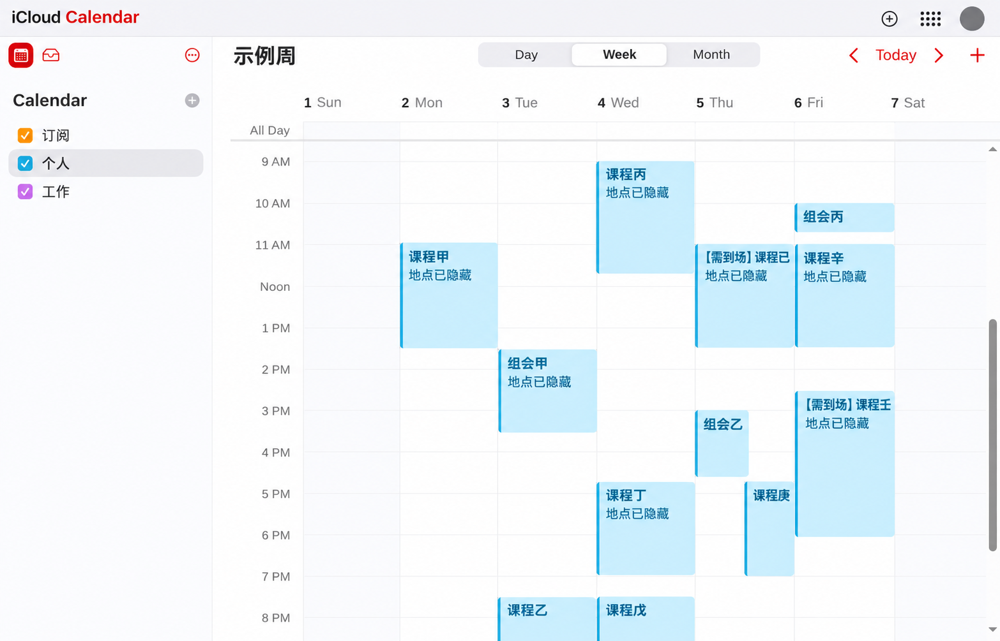
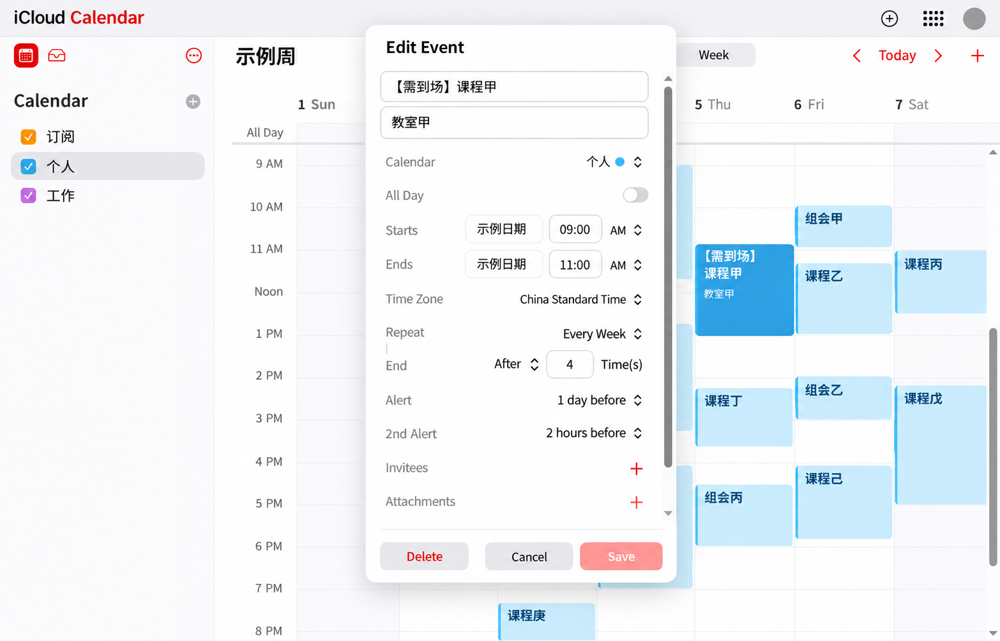
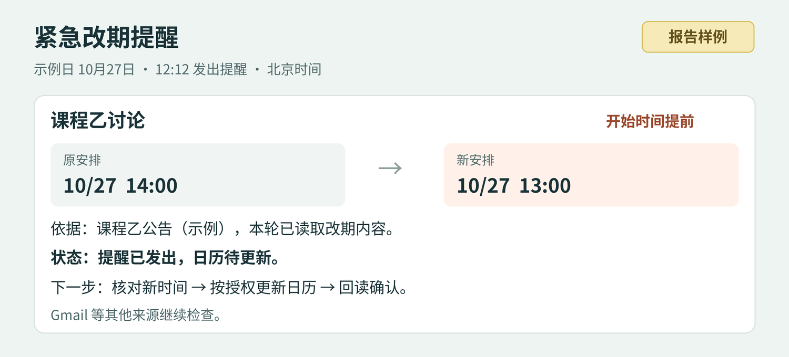
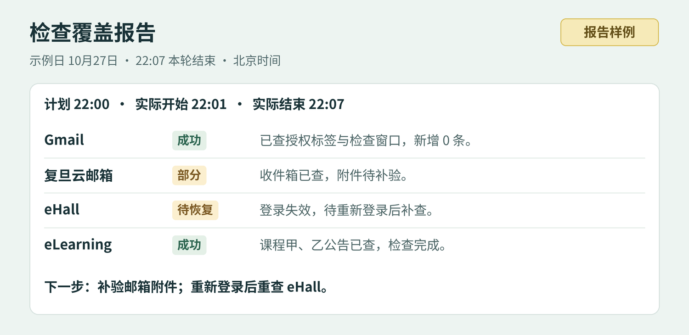

# 用 dot 搭建个人行程管理器

以复旦大学为例，把邮件、课程与会议信息整理成个人日历、待办和提醒；也可替换为其他学校或工作来源。

## 获取与使用本 Skill

本仓库采用 [MIT 许可证](LICENSE)。核心入口为 [SKILL.md](SKILL.md)，完整保留中文使用说明、参考流程、空白台账和图文指南。

通过本页 **Code → Download ZIP** 下载后解压；安装到支持 Skill 的客户端时，选择包含 `SKILL.md` 的目录，并保留 `agents/`、`references/` 和 `assets/` 的相对位置。也可使用：

```bash
git clone https://github.com/Alex4210987/manage-personal-itinerary.git
```

本包提供智能体工作流程；邮箱、浏览器、日历、定时运行与设备通知由宿主环境提供，并需分别接入和授权。持续检查的执行与通知送达取决于宿主运行条件，下载本包不会自动启用后台服务。请将实际账号配置和个人台账保存在仓库外的私有位置。

## 开始使用

告诉 dot 要接入哪些邮箱、课程和会议来源，使用哪个日历，以及你的时区和提醒偏好，即可开始盘点与配置。

> “请帮我建立个人行程管理器，接入我的邮箱、课程平台和会议安排，整理到指定日历。请先与我确认来源、时区和提醒偏好，再开始盘点。”


图 1  个人行程助手工作流程。

<!-- pagebreak -->

## 效果图 日历与事件详情

统一查看每周安排，再在详情中核对时间、重复规则与提醒。



图 2  日历脱敏示意 周视图。



图 3  日历脱敏示意 事件详情。

<!-- pagebreak -->

## 汇报样例 早晚汇总与紧急提醒

早间安排今天，晚间回顾结果与明天；重要改期核实后先行通知。


图 4  汇报样例 早晚汇总。



图 5  汇报样例 紧急改期。

汇总按事项、状态、下一步和来源组织。改期提醒写清原安排、新安排及处理状态，按授权更新日历并回读确认。

<!-- pagebreak -->

## 汇报样例 检查覆盖

逐源查看实际检查范围、结果与后续动作。



图 6  汇报样例 检查覆盖。

这张样例展示四个来源。使用时把腾讯会议等已接入来源一并列入报告，记录各自的实际检查时间与范围。

## 1 选择信息源并完成接入

完成配置后，dot 会把分散的信息整理成带来源和状态的事项清单、个人日历、新信息通知、分阶段提醒、早晚汇总与巡查报告。

本教程使用 Gmail、复旦云邮箱、eHall、eLearning 和腾讯会议，将个人安排统一写入 iCloud 日历。其他学校或工作场景可以沿用同一流程，替换对应网站与账户。

### 先告诉 dot 你的管理偏好

| 要约定什么 | 示例约定 |
| --- | --- |
| 信息源与目标 | 整理上述五类来源，统一使用指定的个人 iCloud 日历。 |
| 时间与身份 | 使用北京时间 Asia/Shanghai；标记必须出席、本人报告、可选活动和待确认事项。 |
| 通知与提醒 | 选择即时通知条件、提前提醒时间、早晚汇总时点，以及完成和忽略事项的处理方式。 |
| 操作授权 | 先读取与整理，确认后写入或更新个人日历；涉及删除、邀请或发信时取得对应授权。 |

### 按来源完成首次读取

优先使用已授权的连接器，也可以通过浏览器访问对应网站。登录时由你完成密码、验证码和二次验证，然后让 dot 读取一条实际记录。

- **Gmail 与复旦云邮箱：**检查相关收件、已发送记录、回复和附件。
- **eHall：**核对个人课表、教学周、教务通知与调整安排。
- **eLearning：**核对课程通知、作业、quiz、提交记录与反馈。
- **腾讯会议：**读取未来会议、会议详情与周期安排，结合历史记录核对。

### 完成四项接入验证

依次确认账户登录、所需内容读取、后续巡查执行和设备通知。为每一步保留实际结果，形成清楚的接入记录。

日历接入时，先确认目标日历，再创建一条获准的测试事件，保存后重新打开，核对时间与时区。

## 2 建立个人事项清单

第一次按学期或选定日期范围做一次完整盘点，建立后续巡查的基线。把事项分为待处理、已完成、已忽略和待确认，并保存在你指定的私有位置。

### 结合上下文判断完成状态

- **邮件事项：**结合后续回复、已发送记录和确认回执判断进展。
- **作业与 quiz：**以提交状态、时间、附件和反馈核实完成情况；成绩显示 0 时继续查看提交记录。
- **多阶段任务：**分别追踪选题、课堂报告与书面报告，每个交付物独立更新状态。
- **已忽略事项：**记录适用范围，后续巡查沿用这个决定；出现新要求时重新核对范围。

### 给每条事项保留这些信息

| 字段 | 记录内容 |
| --- | --- |
| 标题与类型 | 课程、本人报告、作业、quiz、会议或其他；标题写清需要做什么。 |
| 开始与结束 | 原始日期、开始时间与结束时间；日期级事项保留日期精度。 |
| 时区与重复 | 来源和目标时区、教学周或重复规则、起止范围、停课与调课例外。 |
| 地点与出处 | 教室或线上平台、对应邮件或详情页、最近核查时间。 |
| 状态与依据 | 待处理、已完成、已忽略、待确认；注明已核实、用户确认或规则推断。 |
| 去重标识 | 来源稳定标识与发生日期，或规范化标题、时间、来源的组合。 |

遇到不同版本的安排，保留各自出处，核对新版是否替代旧版。仍有分歧时，列出具体差异供你确认。

这份清单也是日历和提醒的共同依据：完成状态更新后，同步调整后续提醒；安排变化后，核对影响并按授权更新日历。

## 3 把课程和截止事项排进日历

从个人课表出发，把学期安排展开为有明确起止范围的日程。先计算课次数量，再批量写入，最后核对首场、末场和特殊日期。

### 按实际教学周展开

- 确认学期起始周、上课日与节次时间，套用连续周、单周、双周及例外日期。
- 为短期政治类课程等分别设置结束周，按各门课的安排处理补课、调课和停课。
- 将教学结束、考试周和个人考试安排分别记录；收到个人考试时间后建立考试事件。

### 按来源精度表达时间

| 来源只说了什么 | 合适的日历表达 |
| --- | --- |
| 本人在某次课堂报告 | 使用整节课的已知时段，备注“本人报告在该课堂内，具体顺序待确认”。 |
| 报告后 7 天交书面材料 | 以实际报告日期计算到期日期，保留计算依据；日期级截止使用全天事项。 |
| 某日截止 | 创建当天的全天截止事项，保留来源对日期的表达。 |
| 已给准确起止时间 | 按原始时区转换后录入，保留来源中的开始与结束时间。 |

### 用标签突出行动要求

可以使用“必到”“本人报告”“可选”“待确认”等简短标签。课堂报告和书面报告截止日建立关联，并分别追踪完成状态。

写入后按类型汇总数量：课程实例、截止事项和会议系列分别统计。复核教学周、重复结束条件与调课例外，让日历与个人安排一一对应。

## 4 整理周期会议并核验日历写入

### 从会议平台读取未来安排

优先使用腾讯会议的未来会议、详情和周期规则，结合历史记录补充核对。 需要从历史规律补全时，经你确认，使用至少两次一致的记录提出周期安排，标注“历史规律推断，待确认”，设置暂定范围与复核日期。

保留来源时区，并换算到你的日历时区。例如 JST 10:00 对应北京时间 09:00；跨午夜时同步调整日期。使用来源提供的结束时间；需要暂定时长时，先与你确认并写入备注。

### 按五步完成日历写入

- **查重：**根据来源标识、发生日期与规范化时间，找到对应的现有事件。
- **逐项填写：**同一日历界面由一个写入流程操作，等待日期、时区和重复选项稳定后继续。
- **保存回读：**重新打开事件，核对标题、目标日历、时间、时区、全天状态、重复边界、例外和提醒。
- **确认保存结果：**遇到超时或结果待确认时，先查找事件，再决定是否补写。
- **复核整体：**按类型核对数量，抽查首场、末场、特殊日期和跨时区事项。

### 跟进改期与取消

收到新通知后，关联已有事件，核对影响，按你的授权更新并回读。存在时间冲突时保留相关安排与来源，向你说明可选处理方式。

每次写入结果都回到事项清单：记录已创建、已更新或待确认，以及对应事件。这样，下一次巡查可以继续处理同一事项。

## 5 配置巡查 通知与早晚汇总

选择适合你的运行模式：定时巡查按约定时点触发；持续循环在完成一轮后，经过设定间隔进入下一轮。配置运行时段、检查范围、健康记录和中断恢复，并停用重叠的旧计划。

### 一组可直接调整的配置示例

| 来源或输出 | 示例配置 | 核对重点 |
| --- | --- | --- |
| Gmail、复旦云邮箱、eHall、eLearning | 持续循环，每轮完成后间隔约 300 秒 | 记录各来源实际检查时间、范围与结果，衔接下一轮。 |
| 腾讯会议 | 每天北京时间 10:00 和 22:00 | 检查未来会议，关联改期与取消，按授权更新。 |
| 早晚汇总 | 每天北京时间 10:00 和 22:00 | 早间安排今天，晚间回顾结果并准备明天。 |

### 选择新信息通知策略

你可以选择“仅重要变化即报”，也可以选择“全部新增信息即报”。dot 在巡查发现并核实后逐源通知，其他来源继续检查；同一新增事项发送一次，完成或明确忽略的事项按你的偏好处理。

新增作业、quiz、邮件任务和会议安排都可以纳入通知。检查频率和通知条件分别配置：前者决定何时查，后者决定查到什么后告诉你。

无变化的例行巡查安静记录，早晚汇总照常发送。重要截止的分阶段提醒与新增通知分别追踪，既能及时知道新任务，也能在临近日期时再次准备。

### 把覆盖与恢复写进每轮报告

逐源记录计划时间、实际完成时间、检查范围、发现数量、处理结果和待补查部分。“新增 0 条”对应本轮已检查的具体范围。

登录失效、读取失败或保存待确认时，报告受影响来源与后续动作；在授权范围内重试，需要你操作时给出步骤，恢复后补查遗漏并去重。首次故障和恢复分别通知，持续故障合并记录。

## 6 配置分阶段提醒并完成设备测试

### 根据事项重要程度设置提前量

重要截止事项可以设置提前 7 天、3 天、1 天和当天提醒；精确到时刻的事项还可以增加提前 2 小时提醒。普通课程与常规会议可以使用更简洁的提醒组合。

日期级事项保持全天；如果希望当天上午收到提示，将它记录为你选择的提醒时点。保存后检查已生效的提醒，并在任务完成或明确忽略后调整后续催办。

### 在 Mac 上检查日历通知

打开“系统设置 → 通知 → 日历”，按设备界面核对下列选项。Apple 的说明也提供了通知开关、事件提醒时间和专注模式的排查方法。

| 界面选项 | 配置动作 |
| --- | --- |
| Allow notifications<br>允许通知 | 开启日历通知。 |
| Desktop / Notification Center / Lock Screen<br>桌面／通知中心／锁定屏幕 | 选择提醒展示位置与锁屏预览偏好。 |
| Alert Style → Persistent<br>提醒样式 → 持续 | 选择持续样式，让提醒保留在屏幕上。 |
| Time sensitive notifications<br>时效性通知 | 按偏好开启，并核对专注模式中的通知设置。 |
| Play sound for notification<br>播放通知声音 | 开启声音，检查音量、输出设备与静音状态。 |

同时确认同一 Apple 账户、iCloud 日历同步、目标日历可见、该日历的提醒已启用，以及事件本身的提醒时间正确。

### 用一条短时测试完成接入

创建一条获准的几分钟后事件，设置短提前量，保存后重开确认。在目标设备上检查通知与声音，记录收到时间，再按约定清理测试事件。

需要使用 Apple“提醒事项”时，也可以完成对应的账户、通知和实机测试配置。

## 7 用三组指令开始使用

### 接入并建立事项清单

> “请帮我统筹个人日程与待办。接入 Gmail、复旦云邮箱、eHall、eLearning 和腾讯会议，统一用北京时间。先读取并整理候选事项、来源和待确认点；需要登录时由我完成验证。”

### 确认后整理个人日历

> “请把已确认、与我本人相关的课程、报告、截止事项和会议写入指定的个人 iCloud 日历。课表覆盖实际教学周，日期级截止用全天。先查重，保存后重开核对，按课程实例、截止事项和会议系列汇总结果。”

### 配置巡查与提醒

> “请帮我选择定时巡查或持续循环，配置检查间隔、运行时段和健康记录。全部新增信息核实后逐源通知，无变化安静记录；每天 10:00 和 22:00 汇总事项与实际覆盖。重要截止按 7 天、3 天、1 天和当天提醒，精确到时刻的事项增加提前 2 小时提醒。”

### 复用工作流

manage-personal-itinerary 将信息核对、日程整理、提醒和巡查步骤封装成可复用工作流。按你的账户、来源、时区和提醒偏好完成配置后，可以这样调用：

> “请使用 manage-personal-itinerary，按本指南帮我建立并维护个人行程管理器。先确认来源、权限与时区，再做首次盘点。”

### 迁移到其他学校或工作场景

**换来源：**将复旦云邮箱、eHall、eLearning 换成你的学校或工作邮箱、教务或事务系统、学习或项目平台；核验官方域名、账户身份与读取范围。

**换配置：**设置时区、学期或工作周期、目标日历、私有事项清单、通知渠道和检查频率，完成新账户授权与提醒测试。

**完成验收：**逐项确认来源可读、事项可追溯、时间与重复规则正确、日历保存回读通过、巡查有执行记录、设备收到测试提醒。

